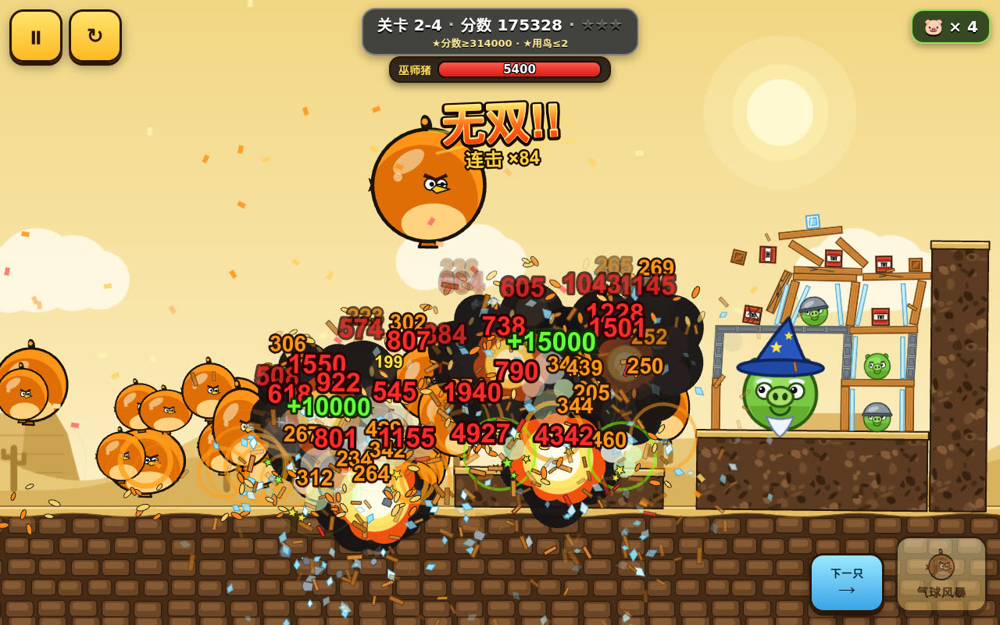

# 愤怒的小鸟 无双版 · Angry Birds Musou

**每只鸟都加强了 10 倍。** A fan-made, over-the-top browser remake inspired by the Bilibili video
[《我给每个鸟加强了10倍，愤怒的小鸟无双版！》(BV1c9ieYaEGw)](https://www.bilibili.com/video/BV1c9ieYaEGw)
by 头牛o. Its rule: **不用管平衡性，怎么离谱怎么来** — so every shot turns into screen-filling chaos within
two seconds: damage numbers flying, forts collapsing, pigs popping.

▶ **Play now: https://kunruiw1991.github.io/angry-birds-musou/** (iPad, phone landscape or laptop; no install)



## How to play

- **Aim**: press the bird on the slingshot (or anywhere on the left third of the screen), pull back, release.
  The dotted arc previews the first part of the flight.
- **无双 ability**: while the bird flies, tap anywhere (or the big 技能 button). Some abilities aim at your
  tap: 史黛拉 hurls everything at it, and 白公主 follows your finger while you hold it down.
- **下一只 →** skips the rest of a turn. Two fingers (or the mouse wheel) zoom, and dragging the empty right side pans.
- Stars: ★ clear · ★ score ≥ the level's target · ★ use no more than the level's bird par.
- Keyboard: Space = ability · R = restart · N = next bird · Esc = pause.

## The 12 birds (each ability buffed 10×)

| 鸟 | 技能 | What the 10× version does |
|---|---|---|
| 胖红 | 风火轮 | 12 mini red birds orbit and grind everything they touch. Tap and the ring flies out as 12 homing ×2-damage missiles with pink trails |
| 蓝弟弟 | 流星分裂 | Splits into an X of 13 birds, and each one calls a meteor 蓝弟弟 down from the sky |
| 飞镖黄 | 激光冲刺 | A 3× speed piercing dash. A laser orb left at the dash origin fires 12 screen-wide lasers |
| 炸弹黑 | 全屏爆破 | 24 chain explosions across the screen, then a mega-blast that flings a ring of 16 TNT crates |
| 白公主 | 投蛋射击 | Hovers for 4 s and rapid-fires ~50 exploding eggs wherever you hold your finger |
| 长嘴绿 | 神鹰回旋 | Turns back like a boomerang and summons 8 Mighty Eagles that dive across the screen |
| 大红 | 巨大化 | Grows to 4× radius and 16× mass, deals ×6 contact damage and lands with a shockwave |
| 泡泡橙 | 气球风暴 | 30 giant orange balloon birds smash down, then float back up |
| 炫舞银 | 空军出击 | Loops and slams down, then an air force of 40 炫舞银 bombs the pigs in 4 waves |
| 波比 | 旋风来袭 | 14 tornadoes rise from the ground and suck up, spin and shred everything |
| 史黛拉 | 重力反转 | Lifts up to 60 objects in pink bubbles, then hurls them all at your tap point |
| 盖雅 | 剧毒斩 | A poison nova that keeps draining HP, then 6 purple lightning slashes across the screen |

## Levels

13 hand-made levels in 3 biomes. 晴空草原 1-1…1-4 is the one-shot power fantasy, ending with
钢盔猪将军. 黄沙大漠 2-1…2-4 has taller forts and ends with 巫师猪 (5400 HP). 夜色都市 3-1…3-4
spreads wide clusters and ends at 猪王城堡 with 猪王 (11578 HP). The bonus level 3-5 无双乱斗 gives you
all 12 birds against a 300-plus-block mega fortress, and it unlocks after you clear 3-4.

## Tech

- Zero-build ES2022 modules, plain HTML + Canvas 2D. No bundler, CDN or image/audio files: all art is procedural.
- Physics: [planck.js](https://github.com/piqnt/planck.js) (Box2D port, MIT) vendored in `vendor/`. The sim runs
  at a fixed 60 Hz, separate from rendering, and is deterministic per seed. Damage counts only impacts
  (impulse × approach speed), so standing towers never chip themselves.
- Juice: hit-stop, trauma screen shake, slow-mo on mega moments, merged damage numbers, 连击 / 大破坏 / 无双 combo text, up to 900 debris particles.
- Audio: procedural WebAudio SFX and three original 6/8 biome tunes (no speech synthesis, no audio files).
- Progress is saved in `localStorage['musou_progress']`.
- Test seam: `window.__MUSOU__` (`startLevel`, `launch`, `useAbility`, `stepFrames`, `getState`, …).

## Run locally & tests

```bash
python3 -m http.server 8000      # then open http://localhost:8000/
python3 tests/smoke.py           # 13-level headless smoke (~10 s)
python3 tests/run_e2e.py         # E2E suite (headless Chrome via CDP)
python3 tests/layout_audit.py    # 4-viewport layout audit
python3 tests/sim_gates.py       # fun gates G1–G12 (random/aimed policies)
```

## Changelog

- **v1.0**: 12 birds with 10× abilities, 13 levels, bosses with HP bars, first-time coach hints, stars and
  progress, 4-viewport responsive HUD, juice and audio, and E2E, layout and fun-gate test suites.

*Fan tribute, non-commercial. Angry Birds is a trademark of Rovio Entertainment. This project uses no
original game assets: every sprite and sound is generated in code.*
